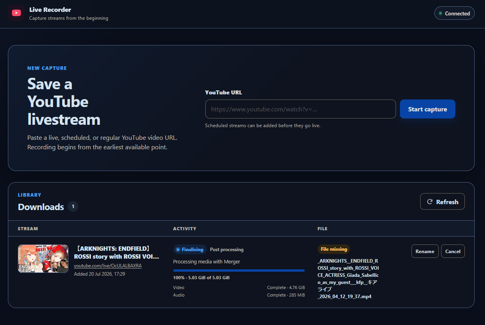

# YouTube Live Downloader



A small self-hosted web application for recording YouTube livestreams from the
earliest point YouTube still makes available. Scheduled streams can be queued
before they begin, and regular YouTube videos are supported too.

The Web UI shows the stream title and thumbnail, one coherent progress view,
durable history, actionable failures, and the state of the finished file on
disk.

## Features

- Capture live and scheduled streams with yt-dlp's live-from-start support.
- Choose between a normal video capture and an MP3 audio-only capture when adding
  a link.
- Read the source title and thumbnail automatically.
- Track video, audio, merging, speed, size, and ETA without progress jumping
  between separate media parts.
- Limit concurrent captures while retaining a durable queue in SQLite.
- Resume active jobs automatically after crashes or graceful service restarts.
- Show download failures and allow failed, cancelled, or interrupted jobs to be
  retried.
- Rename a download; completed files are renamed safely on disk as well.
- Play completed videos and MP3 captures in the browser from the row action or by
  clicking the card thumbnail, or download or delete a media file independently of
  its history entry.
- Turn a completed video capture into an MP3 capture from the Download button's
  menu: ffmpeg re-reads the stored file, so nothing is fetched from YouTube again.
- Remember where browser playback stopped and offer to resume that file from the
  same position next time.
- Report common failures in plain language — unavailable, private, members-only,
  age-restricted, region-blocked, sign-in walls, missing formats, network and
  storage problems — while keeping the raw extractor message alongside them.
- Detect files removed outside the application and report them as missing.
- Optionally protect the UI and API with HTTP Basic authentication.

## Docker Compose quick start

The supplied Compose configuration builds the application locally, runs it as
UID/GID `10001`, uses a read-only container filesystem, and publishes it only on
the host loopback interface.

From a checkout of this repository:

```bash
mkdir -p downloads
sudo chown 10001:10001 downloads
sudo chmod 0750 downloads

docker compose up --build -d
docker compose ps
```

Open <http://127.0.0.1:5000>. Follow logs with:

```bash
docker compose logs -f yt-live-downloader
```

To use another host port, set `PORT` for Compose; the container continues to
listen on port 5000:

```bash
PORT=8080 docker compose up --build -d
```

The `downloads` directory holds both media and application state. Do not replace
the bind mount with a temporary container directory.

### Add authentication to Compose

For a shared machine, add a Compose override such as `compose.auth.yml`:

```yaml
services:
  yt-live-downloader:
    environment:
      USERNAME: recorder
      PASSWORD_FILE: /run/secrets/recorder-password
    volumes:
      - ./secrets/recorder-password:/run/secrets/recorder-password:ro
```

Create `secrets/recorder-password` outside source control, make it readable by
UID `10001`, and start both files:

```bash
sudo chown 10001:10001 secrets/recorder-password
sudo chmod 0400 secrets/recorder-password
docker compose -f docker-compose.yml -f compose.auth.yml up --build -d
```

`PASSWORD` can be used instead, but a mounted `PASSWORD_FILE` avoids putting the
password directly in the Compose environment.

## Direct Docker run

```bash
docker build --pull -t yt-live-downloader:local .

docker run -d \
  --name yt-live-downloader \
  --restart unless-stopped \
  --publish 127.0.0.1:5000:5000 \
  --env DOWNLOAD_DIR=/data \
  --env MAX_CONCURRENT_DOWNLOADS=6 \
  --mount type=bind,source="$PWD/downloads",target=/data \
  --read-only \
  --tmpfs /tmp:rw,size=128m,mode=1777 \
  --cap-drop ALL \
  --security-opt no-new-privileges \
  --pids-limit 256 \
  yt-live-downloader:local
```

Create and `chown` the `downloads` directory as shown in the Compose quick start
before running this command. Add `USERNAME` and either `PASSWORD` or a mounted
`PASSWORD_FILE` when authentication is required.

## Automated Docker Hub publishing

The GitHub Actions workflow in `.github/workflows/publish-image.yml` runs the
tests and Ruff checks on every push to `main`. If they pass, Release Please
creates or updates a release pull request, and the workflow builds the Docker
image and pushes these tags to Docker Hub:

- `latest`;
- a UTC date plus the short Git commit, such as `20260822-a1b2c3d`, so multiple
  pushes on the same day do not overwrite one another;
- the semantic version with and without a `v` prefix, such as `1.2.0` and
  `v1.2.0`, when that push creates a GitHub Release.

Every commit merged to `main` that passes the tests builds a new image, so each
image is also expected to carry a version. `release-please-config.json` therefore
lists `chore`, `deps` and `build` as release-producing commit types alongside
`fix`, `feat`, `perf` and `revert`, so dependency bumps and packaging changes cut
a patch release instead of publishing an unversioned image. `docs`, `style` and
`test` stay hidden from the changelog.

The same test and Ruff checks run when a pull request targeting `main` is opened
as non-draft or marked ready for review. They rerun after subsequent commits or
when the pull request is reopened. Draft pull requests skip the checks, and pull
request workflows never create releases or publish images.

Create the target repository on Docker Hub, then configure the following under
the GitHub repository's **Settings > Secrets and variables > Actions** page:

| Type | Name | Value |
| --- | --- | --- |
| Variable | `DOCKERHUB_USERNAME` | The Docker Hub user that owns the access token. |
| Variable | `DOCKERHUB_IMAGE` | The complete image name, for example `dalgibbard/yt-live-downloader`. |
| Secret | `DOCKERHUB_TOKEN` | A Docker Hub personal access token with Read & Write access. |

To create the token, open Docker Hub, go to **Account settings > Personal access
tokens**, generate a token with an expiry and **Read & Write** access, and copy it
when shown. Store the token as the GitHub secret; do not add it to this repository
or put it directly in the workflow.

The same configuration can be added with the GitHub CLI. The secret command
prompts for the token without placing it in the command itself:

```bash
gh variable set DOCKERHUB_USERNAME --body "your-dockerhub-username"
gh variable set DOCKERHUB_IMAGE --body "your-dockerhub-username/yt-live-downloader"
gh secret set DOCKERHUB_TOKEN
```

### Release process and notifications

Release Please collects commits that follow the Conventional Commits format and
maintains a release pull request containing the next version and `CHANGELOG.md`.
Use `fix:` for a patch, `feat:` for a minor release, and a `!` or a
`BREAKING CHANGE:` footer for a major release. For example:

```text
fix: handle YouTube CDN 403 responses
feat: support Docker Hub publishing
feat!: change the persisted download schema
```

The first proposed release is configured as `1.0.0`. Merging a Release Please
pull request causes the next successful `main` workflow to create the version
tag and published GitHub Release, then add both the unprefixed and `v`-prefixed
semantic versions to the Docker image. Release Please uses GitHub's built-in
`GITHUB_TOKEN`; no additional GitHub API token needs to be stored.

In the GitHub repository's **Settings > Actions > General** page, enable **Allow
GitHub Actions to create and approve pull requests**. The workflow grants write
access only to the Release Please job; if an organisation policy blocks those
job-level permissions, an organisation administrator must allow them.

Users can receive release notifications by selecting **Watch > Custom >
Releases** on the GitHub repository page. The generated changelog is included in
each GitHub Release.

### Forcing a release or retyping a merged commit

A merge that release-please considers non-releasable still builds and publishes
an image, so it needs a manual nudge to also produce a version. Both options are
documented release-please features:

- Put `Release-As: 1.2.1` in the commit body of a commit pushed to `main`. The
  next `main` workflow cuts exactly that version regardless of commit type, and
  the footer is read once, so it does not pin future releases.
- Add a `BEGIN_COMMIT_OVERRIDE` block to the body of an already merged
  squash-merged pull request to change the message release-please uses for the
  changelog:

```text
BEGIN_COMMIT_OVERRIDE
chore(deps): bump gunicorn, yt-dlp, pytest and ruff
END_COMMIT_OVERRIDE
```

## Runtime dependencies

`requirements.txt` pins the runtime set used for local development.
`requirements-docker.txt` holds the same pins for the container image, minus the
`deno` extra: the image installs Deno from the Alpine package repository, because
the PyPI `deno` wheel is glibc-only and cannot build on the image's musl base.
When a release cuts, its `CHANGELOG.md` entry names the versions that image
contains.

| Package | Pinned version | In image |
| --- | --- | --- |
| `Flask` | 3.1.3 | yes |
| `gunicorn` | 26.2.0 | yes |
| `yt-dlp[default,deno]` | 2026.10.26 | yes (`[default]`; Deno from `apk`) |

The image also installs `ffmpeg`, `tini`, and `deno` as Alpine packages. Audio-only
captures rely on ffmpeg's `libmp3lame` encoder, which the Alpine `ffmpeg` package
provides.

## Local Python development

Python 3.13 is recommended. Install `ffmpeg` with the operating system package
manager first; the Python requirements provide yt-dlp and its Deno JavaScript
runtime support.

```bash
python3.13 -m venv .venv
. .venv/bin/activate
python -m pip install -r requirements-dev.txt
mkdir -p downloads
python app.py
```

The development server listens on <http://127.0.0.1:5000> by default. It is not a
production server; the container runs Gunicorn instead.

Run the checks with:

```bash
python -m pytest
ruff check .
ruff format --check .
```

## Configuration

| Variable | Default | Purpose |
| --- | --- | --- |
| `DOWNLOAD_DIR` | `./downloads` locally; `/data` in Docker | Media files, SQLite history, and worker state. Must be writable. |
| `MAX_CONCURRENT_DOWNLOADS` | `6` | Maximum simultaneous capture workers. Values are constrained to `1`–`16`. |
| `USERNAME` | unset | Enables Basic Auth when supplied with one password option. |
| `PASSWORD` | unset | Basic Auth password. Mutually exclusive with `PASSWORD_FILE`. |
| `PASSWORD_FILE` | unset | Path to a file containing the Basic Auth password; preferred for containers. |
| `YTDLP_CONCURRENT_FRAGMENTS` | `4` | Parallel fragments per active yt-dlp worker, constrained to `1`–`16`. |
| `LOG_LEVEL` | `INFO` | Worker log level, such as `DEBUG`, `INFO`, or `WARNING`. |
| `HOST` | `127.0.0.1` | Bind address used by `python app.py` only. |
| `PORT` | `5000` | Port used by `python app.py`; also selects the host-side port in the supplied Compose file. |

`USERNAME` and exactly one of `PASSWORD` or `PASSWORD_FILE` must be set together.
Invalid or incomplete authentication configuration stops the application at
startup rather than silently running without protection.

## Architecture

```text
Browser
   │
   ▼
Flask/Gunicorn coordinator ── SQLite history and queue
   │
   └── bounded, supervised worker processes ── yt-dlp ── ffmpeg
```

The Python coordinator owns the API, queue, and durable SQLite state. Each active
capture runs separately under supervision, with transactional progress updates
written to SQLite. yt-dlp handles YouTube extraction and downloads; ffmpeg handles
media merging and finalisation. The production image intentionally runs one
Gunicorn process with multiple threads so that there is only one queue owner.

On graceful service shutdown, the coordinator invalidates each active worker,
keeps its staging files, and persists the job as queued before terminating the
process group. Startup claims those jobs automatically. Explicitly cancelled jobs
remain cancelled and are never resumed automatically.

A Go rewrite would add risk without removing the fast-changing yt-dlp integration
or the need for ffmpeg. The expensive and failure-prone media work already runs
outside the coordinator, so Python's GIL is not the current throughput limit.
Revisiting Go would make sense if measurements show the coordinator itself is a
bottleneck or the application needs multi-host scheduling.

## Capture modes

Each download records how it was captured, chosen next to the **Start capture**
button:

| Mode | Worker behaviour | Final file |
| --- | --- | --- |
| `video` (default) | Best video and audio merged into one container. | `.mp4` or `.mkv` |
| `audio` | Best audio stream only, transcoded to MP3. | `.mp3` |

The choice is stored per job and returned as `mode` on `/api/downloads`;
`POST /api/downloads` accepts `{"url": "...", "mode": "audio"}`. Audio-only jobs
are labelled `MP3 audio only` in the list and play in the browser like any other
completed file. Existing databases gain the column automatically on startup, so
older jobs keep the `video` mode they were captured with.

### Extracting an MP3 from a captured video

A completed **video** capture can produce an MP3 without re-downloading anything.
The Download button on a video row splits into a menu with *Download the captured
file* and either *MP3 audio only* (extract one now) or *Download the MP3 capture*
(when one already exists). Choosing *MP3 audio only* calls
`POST /api/downloads/<id>/audio`, which queues a second capture marked
`audio_only` and records the parent job in `derived_from`. The worker skips
yt-dlp entirely for those jobs and runs ffmpeg against the stored media file,
reporting extraction progress as a single audio part.

Extraction is idempotent: a second request for the same parent returns the
capture that already exists rather than queueing another one. It is refused with
`409` when the parent capture is still running, when it is already an audio
capture, or when its file is missing or deleted. The derived MP3 is an ordinary
capture afterwards — its own row, its own download, delete, rename, playback, and
resume state, and deleting the parent's video file leaves it in place.

## Playback and resume

The player opens from the row's **Play** action or by clicking the card thumbnail,
which gains a play overlay on hover or focus. Only formats the browser can decode
inline are offered playback.

Each browser remembers its own last position per job in local storage, saved while
playing and when the dialog closes. Reopening an available file resumes from that
position, shows a short banner saying where it resumed, and marks the card
thumbnail with the watched fraction. A position is forgotten when the file ends,
when it is close to the end, or when the media file or history entry is deleted.
Resume state is per browser and device; it is never stored on the server or shared
between them.

## Download and file states

Download state describes the job:

| State | Meaning |
| --- | --- |
| `queued` | Waiting for an available worker slot, including work paused during service shutdown. |
| `inspecting` | Reading YouTube metadata and selecting formats. |
| `waiting_live` | A scheduled stream has not started yet. |
| `downloading` | Capturing the available video/audio data. |
| `post_processing` | Merging, naming, and finalising the media file. |
| `completed` | Capture and finalisation succeeded. |
| `failed` | The attempt ended with an error; details are shown in the UI. |
| `cancelled` | A user stopped the capture. |
| `interrupted` | A worker was interrupted outside normal service shutdown, or a legacy job ended unexpectedly. |

File state is tracked separately:

| State | Meaning |
| --- | --- |
| `pending` | The job is active and has no final file yet. |
| `available` | The recorded path exists and can be downloaded or deleted. |
| `missing` | A recorded path no longer exists, usually because the file was removed outside the application. |
| `deleted` | The file was deliberately deleted through the Web UI. |
| `unavailable` | The job has no usable final file, commonly after a failure or cancellation. |

### Failure messages

A failed job stores two strings: `error_summary`, shown in the row and the
failure toast, and `error_detail`, the raw extractor or ffmpeg message kept for
diagnosis and rendered under the summary. yt-dlp wording is mapped onto something
actionable — "This video is no longer available on YouTube", "This video is
private", "This video is members-only", "This video is age-restricted", "YouTube
asked for a sign-in before it would serve this video", "This video is not
available in your region", "YouTube did not offer a format that can be
downloaded", "YouTube is rate limiting these requests", "YouTube could not be
reached", "A required download tool is missing", "The download storage is full" —
and anything unrecognised falls back to a generic summary rather than the
previous blanket "The download failed unexpectedly". Mapping never rewrites the
detail, so the original message is always recoverable.

## Actions and data ownership

- **Rename** changes the displayed title immediately. An available completed file
  is also renamed safely; existing files are never overwritten.
- **Cancel** stops an active capture but keeps its history entry. Partial worker
  artifacts are retained so a retry can resume where yt-dlp supports it; removing
  the history entry cleans them up.
- **Retry** starts a new attempt for a failed, cancelled, or interrupted job.
- **Download** transfers an available media file through the browser.
- **Delete file** permanently removes only the media file. The history entry stays
  and is marked `deleted`.
- **Remove history** removes the SQLite/UI entry and internal status artifacts. It
  never deletes the media file; an available file becomes unmanaged on disk.

Active jobs must be cancelled before their file or history can be removed. A file
deleted manually from `DOWNLOAD_DIR` is reported as `missing`; its history is not
silently discarded.

Titles are stored as Unicode in SQLite. Final filenames are NFKC-normalised,
UTF-8 byte-limited, and retain Japanese text, combining characters, emoji
variation selectors, emoji ZWJ sequences, and linguistic join controls. Unsafe
filesystem punctuation, control characters, bidi formatting controls, and other
invisible format characters are removed from the filename.

## Upgrading from the legacy JSON application

On the first start with a new database, the application looks for
`downloads_metadata.json` in `DOWNLOAD_DIR` and imports it once into
`downloads.sqlite3`:

- legacy `finished` or `completed` entries become `completed`;
- legacy `failed` or `error` entries become `failed`;
- all other entries become `interrupted` and can be retried.

Only media paths safely contained within `DOWNLOAD_DIR` are retained. The legacy
JSON file is left untouched. Back up the whole directory and validate the JSON
before upgrading: the migration records a failed attempt instead of repeatedly
retrying malformed input.

## Backups and updates

Stop the application before a filesystem-level backup so SQLite, its WAL files,
history, and media are captured consistently:

```bash
docker compose stop
sudo tar -C . -czf yt-live-downloader-backup-YYYYMMDD.tar.gz downloads
docker compose start
```

Captures that were active when Compose stopped are reclaimed automatically and
reuse their partial staging data after startup.

YouTube changes frequently, so yt-dlp freshness matters. Pull repository updates
and rebuild on a regular cadence (weekly is practical) and promptly when
extractor failures begin:

```bash
git pull
docker compose build --pull
docker compose up -d
```

Dependencies are deliberately pinned in `requirements.txt`. Maintainers should
update the yt-dlp pin, run the test/lint commands, and rebuild the image. Do not
run `yt-dlp -U` inside an immutable running container.

## Troubleshooting

- **`Permission denied` under `/data`:** verify the bind-mounted directory is
  owned by UID/GID `10001` and is writable. Rootless Docker/Podman installations
  may require the equivalent user-namespace ownership mapping.
- **JavaScript-runtime or ffmpeg errors:** the Docker image includes Deno support
  and ffmpeg. For local development, reinstall the pinned Python requirements and
  confirm `ffmpeg -version` works. Rebuild from current dependencies after YouTube
  player changes.
- **A capture failed or appears stuck:** expand the error in the UI, then inspect
  `docker compose logs yt-live-downloader`. Check network access, free disk space,
  system time, the source URL, and the yt-dlp version before using **Retry**.
- **The UI cannot reach the service:** run `docker compose ps` and check
  `curl http://127.0.0.1:5000/healthz`. The health endpoint intentionally returns
  only service status and is not protected by Basic Auth.
- **A completed file says `missing`:** restore it at its recorded path or remove
  the stale history entry. Removing history does not remove any other file.

## Network security

HTTP Basic Auth encodes credentials; it does not encrypt them. Keep the default
loopback binding and, if the service must be reachable from another machine, put
an HTTPS reverse proxy such as Caddy, nginx, or Traefik in front of it. Preserve
the original `Host` header, enable `USERNAME` plus `PASSWORD_FILE`, and do not
publish the container's plain HTTP port directly to an untrusted network.

## Legal use

Download only streams and videos that you own or are authorised to retain. You
are responsible for complying with copyright law, YouTube's terms, and any other
rules that apply in your jurisdiction. This project is not affiliated with or
endorsed by YouTube or Google.
